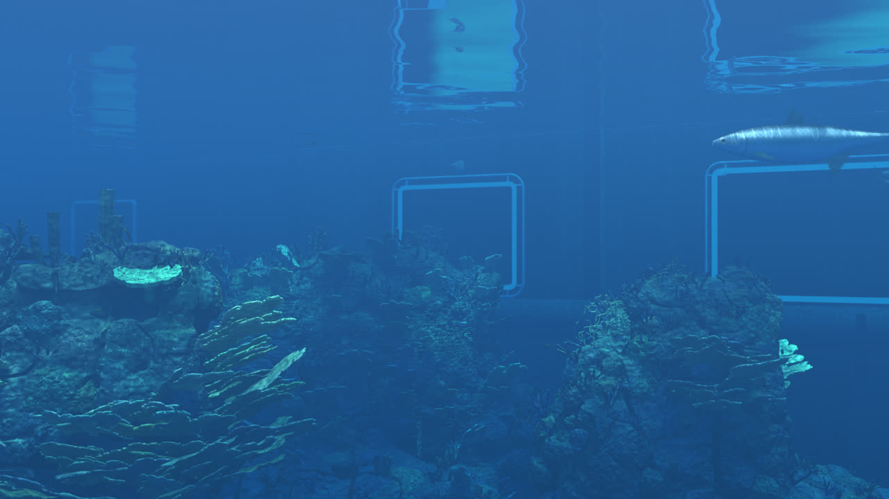

# Reality.js — the aquarium

A big reef tank seen through the viewing window, drawn in the browser with nothing but three.js.
No photos, no video, no texture images, no 3D models. The rockwork, corals, back wall, fish, light and water are all generated in code.

**Open in your browser: https://aiimpl.github.io/reality-js-aquarium/**



## What's in it
- An 18-second shot from a phone held still against the glass: tarpon gliding past, a school of jacks, small reef fish
- Reef rock with about 2,800 coral colonies grown on its surface (plate and elkhorn corals, domes, brain corals, branching heads, tube sponges, sea fans, a table coral)
- Hard light from lamps above: lit tops, deep blue undersides, pools of light, and caustics that shimmer across the reef
- The water surface seen from below: total internal reflection that mirrors the tank and the fish, wobbling with the ripples
- Silver fish built from code: overlapping round scales that flash as the body bends, fins with rays, breathing gill covers, round glossy eyes
- Export: 1920×1080, 30 fps PNG sequence and mp4

## Requirements
- Viewing: a browser with WebGL2 (Chrome / Safari / Edge). The page bakes the tank first (a few seconds), then runs in real time
- Exporting: Python 3.10+, Google Chrome, ffmpeg

## Usage
```sh
make serve            # open http://127.0.0.1:8797/ (?t=10 starts at 10 s)
make setup            # install Playwright for exporting
make video            # 548 frames into build/frames → build/aquarium.mp4
```
At full quality the bake takes about 1.5 minutes and each frame about 0.4 s on an Apple silicon Mac.

URL options for export (`?render`): `ss` supersampling (default 2), `sub` motion-blur sub-frames (2), `nj` bake samples per pixel (4), `tile` bake tile size in pixels (96).
`?fishtest=i,yaw` parks fish number *i* in front of the camera to look at it closely.

## How it works
- **Bake, then composite** (`world.js`, `main.js`): the static tank is ray marched once as a signed distance field into float render targets, split into the light that arrives from above (so caustics can be multiplied in later), everything else, and the world position. Two views are baked: the camera's, and the view in the mirror of the water surface. Each frame then only composites: caustics, the rippled mirror lookup, and the fish and particles drawn as ordinary meshes on top with matching depth
- **Water**: closed-form single scattering along each ray (red is absorbed first), downwelling light that fades with depth, forward-peaked phase so looking up toward the lamps is brighter, a slight veil of light from the thick acrylic panel
- **Reef** (`reef.js`): rock piles are lumps melted together with smooth minimum and pushed around by noise. Colonies are scattered on the rock on the CPU with Poisson-like spacing, each made of primitives (capsules for branches, flat forking blades, squashed domes, tubes, fan nets). The primitives go into a uniform grid stored in float textures, so the shader only evaluates the few listed in the cell it is in
- **Light**: two lamps above (a narrow main one and a weaker one toward the viewer) with soft shadows, ambient light from the water occluded by nearby rock, lamp pools, a fast fine caustic net projected along the light
- **Fish** (`fish.js`): bodies are lofted from a profile table, swim by a travelling wave in the vertex shader with the tail beat integrated from the swimming speed, and bend into turns. The skin shader lays out overlapping scales, gives each its own tilt, and reflects the surrounding water and lamps. Fish are sorted far to near every frame; each is drawn twice, once for the camera and once into the surface mirror
- **Particles** (`particles.js`): drifting specks, out-of-focus discs close to the lens
- **Post**: supersampling, motion-blur sub-frames, a gentle shoulder, a little sensor noise

## Files
```
index.html        page
main.js           renderer, bake, camera, per-frame composite, export entry points
world.js          water model, tank distance field, lighting, bake and composite shaders, post
reef.js           reef layout on the CPU, noise texture, primitive grid
fish.js           fish geometry, swimming, skin and fin shaders, choreography
particles.js      suspended particles
tools/render.py   opens Chrome and saves one PNG per frame
tools/encode.sh   PNG sequence → mp4 (yuv420p)
vendor/three      three.js r160 (MIT)
```

## License
MIT (`LICENSE`). three.js is MIT as well, see `vendor/three/LICENSE`.
